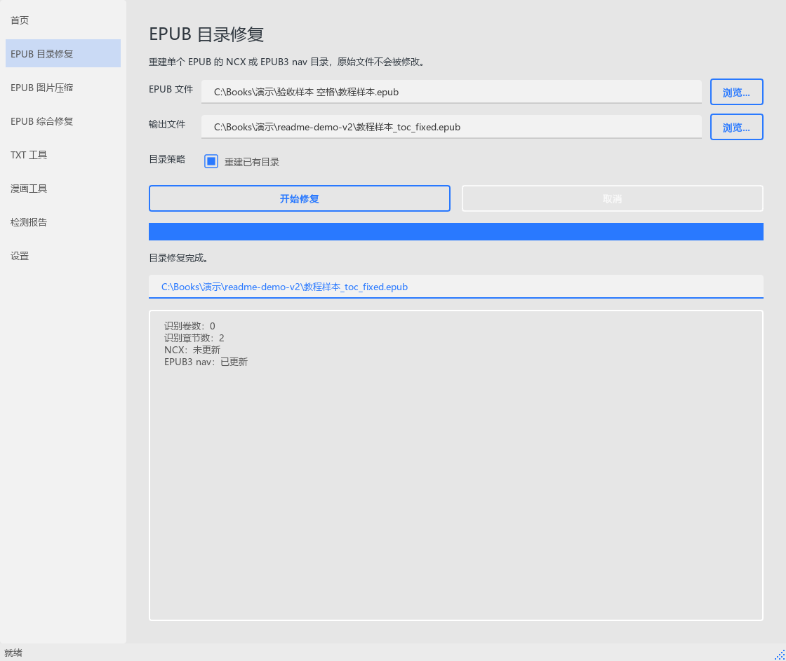
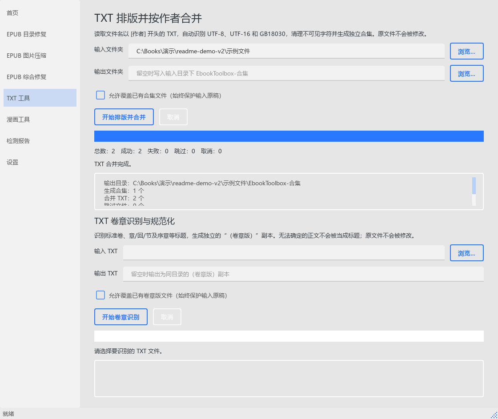
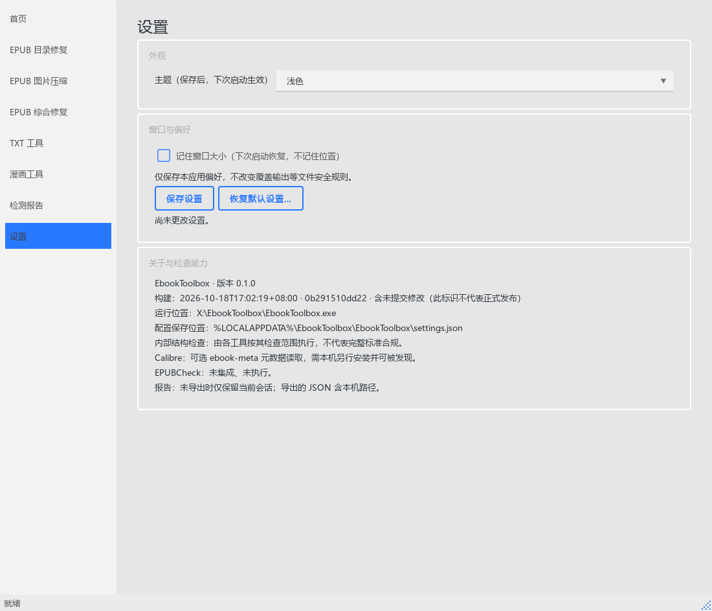

<p align="center">
  
</p>

<h1 align="center">EbookToolbox · 电子书工具箱</h1>

<p align="center">在 Windows 上修复 EPUB 目录、压缩图片，整理与合并 TXT。</p>

<p align="center">
  <a href="https://github.com/konghenfuxue-cpu/EbookToolbox/releases/download/v0.1.0/EbookToolbox-portable.zip"></a>
  <a href="docs/BEGINNER_GUIDE.md"></a>
</p>

**[下载便携版 ZIP](https://github.com/konghenfuxue-cpu/EbookToolbox/releases/tag/v0.1.0) · [从零开始使用](docs/BEGINNER_GUIDE.md) · [验证范围](docs/beginner-verification.md)**

> **先选对版本：**最新正式包仍是旧版 v0.1.0。下方截图和后续 TXT 写入保护来自 `main`，旧包不包含全部改进。需要新版修复时，请按[源码启动教程](docs/BEGINNER_GUIDE.md#新版源码路线可选)操作；两者版本号相同，不能只看“0.1.0”判断内容。

## 实际效果



使用原创的两章 EPUB 完成目录重建。截图来自实际 Qt 程序运行，显示路径已脱敏；不是旧 Release 的界面或真机兼容性证明。

<details>
<summary>再看 TXT 合并结果与设置页</summary>





</details>

## 三步开始

| 步骤 | 操作 | 做完后应该看到 |
| --- | --- | --- |
| 1 · 下载 | 在 [v0.1.0 的 Assets](https://github.com/konghenfuxue-cpu/EbookToolbox/releases/tag/v0.1.0) 选 `EbookToolbox-portable.zip` | 一个完整 ZIP；`Source code` 不是现成程序 |
| 2 · 解压 | 右键“全部解压缩”，保留 EXE 与同层 `_internal`，双击 `EbookToolbox.exe` | 左侧工具导航；基本使用不需安装 Python 或管理员权限 |
| 3 · 试一份副本 | 打开“TXT 工具”，选择装有两个 `[作者]` TXT 的练习文件夹，输出留空并开始合并 | 输入目录下出现 `EbookToolbox-合集`，原 TXT 保留 |

首次练习的文件名、正文、输出核对和错误恢复，按[完整教程](docs/BEGINNER_GUIDE.md#最小练习合并两个-txt)逐项操作。建议 Windows 11 x64；其他环境的验收范围见验证记录。

## 能做什么

| 工具 | 用途 | 输出与注意事项 |
| --- | --- | --- |
| EPUB 目录修复 | 识别卷章，重建 NCX / EPUB 3 nav | 生成新 EPUB，仍需用阅读器核对目录跳转 |
| EPUB 图片压缩 | 压缩 JPEG、PNG、静态 WebP，可选策略与封面处理 | 首先试一本副本，核对画质 |
| EPUB 综合修复 | 修复可确定的内部路径、资源引用和 OPF 结构，支持顺序批量处理 | 显示逐文件结果；缺失正文不能靠结构修复补回 |
| TXT 工具 | 按作者排版合并，或识别卷章生成独立副本 | 自动识别 UTF-8、UTF-16、GB18030；新旧包的保护范围有差异 |
| 检测报告与设置 | 查看会话结果、导出 JSON；新版可设置主题与窗口偏好 | 未导出报告随关闭丢失，JSON 中的本机路径分享前需脱敏 |

各工具单独运行。当前“漫画工具”是保留入口，尚未开放。内部结构检查、可选 Calibre 元数据读取与 EPUBCheck 不是同一件事；当前未集成 EPUBCheck。

## 常见问题

**为什么没有 EXE？** 你可能下载了源码 ZIP。普通便携包在 Release 的 Assets 中，文件名含 `portable`。

**为什么 EXE 提示缺少 DLL 或 `_internal`？** 重新完整解压到新文件夹，不要只复制 EXE。校验值与启动排查见教程，不从下载站补 DLL。

**文件保存在哪里？** TXT 合集默认在输入目录的 `EbookToolbox-合集`；EPUB 修复默认在原文件旁生成新文件，以结果区域显示的位置为准。

**取消后为什么已有部分结果？** 某些批量任务会保留已完成的输出，取消不代表全部回滚。保留原稿，只核对和重试失败项。

**新版截图与我下载的不同？** 正式包仍是旧版；需要后续修复和设置页时，使用源码路线。更多问题见[教程的恢复说明](docs/BEGINNER_GUIDE.md#文件保存更新与恢复)。

## 开发环境运行

开发命令、构建步骤和服务层说明保留在下方。普通用户先按上面的便携包或[源码使用教程](docs/BEGINNER_GUIDE.md)操作即可。

<details>
<summary>开发、构建与文件安全细节</summary>

所有工具默认都不会覆盖源文件。TXT 合并默认输出到输入目录下独立的
`EbookToolbox-合集` 文件夹；各工具相互独立，不会被其他页面自动串联执行。

TXT 服务和界面统一保护输入原稿：即使显式 `overwrite=True`，也拒绝同路径、
大小写等价路径、符号链接或硬链接指向输入的输出。允许覆盖的仅是预检时已存在的
普通非原稿输出；预检后新出现或变化的目标会拒绝发布。整批作者合集在创建输出前
检查重名、名称清理后的碰撞和已有输出冲突，冲突时整批拒绝；读取某作者任一输入
失败时不发布该作者的不完整合集，其他无冲突作者可独立完成。取消或后续 I/O 失败
不会回滚已成功发布的其他作者合集。临时文件清理失败会保留文件并报告。
相对路径在入口固定为绝对路径；输入/输出身份无法确认时拒绝写入。
不支持以设备名、ADS、尾部点/空格或已有链接作为输出。
这些检查不提供跨进程锁：请勿在转换期间由其他程序改动输入、输出或其父目录。

## 独立资源页脚本

`scripts/epub-resource-pages/` 保留两组独立的 EPUB 资源页模板与插入脚本：
`personal-collection/` 和 `yandere/`。它们不是 GUI 功能，不会随工具页面自动运行，
也不会自动打入便携程序。模板包含维护者已有的网盘分享链接、提取码及频道链接；
这些链接不属于软件依赖，未验证其长期可用性。使用前阅读对应脚本参数，并先在
EPUB 副本上操作；此处纳入版本管理不等于完成这些独立脚本的安全验收。

## 设置

“设置”页可选择浅色/深色主题，保存后下次启动生效；可选正常关闭时记住窗口
大小（不记住位置，恢复时限制在当前屏幕范围）。浅色为默认主题。
配置位于当前用户的 Qt AppConfigLocation 下 `settings.json`，具体路径显示在设置页；
不会写入安装目录、注册表或修改工具的覆盖输出规则。保存失败会明确提示。
修改选项后即时提示未保存；离开设置页或关闭窗口时可选择保存、放弃或取消。
保存失败会保留更改并阻止离开，取消则停留当前页面。
“恢复默认设置”只重置主题与窗口偏好，需确认，不删除书籍、输出或本次报告。
关于区域显示版本、构建日期、短提交号、构建时工作区修改状态和运行位置；
没有构建信息时明确显示未知，构建标识不代表正式发布。另区分内部结构检查、可选 Calibre 元数据读取和
尚未集成的 EPUBCheck。配置损坏时提示并回退默认，不在启动时自动改写损坏文件。

## 开发环境运行

需要 Windows、Python 3.11 或更高版本，以及
[uv](https://docs.astral.sh/uv/)。在 PowerShell 中进入项目根目录：

```powershell
uv sync --dev
uv run python main.py
```

也可以使用模块入口：

```powershell
$env:PYTHONPATH = "src"
uv run python -m ebook_toolbox
```

项目不绑定特定 Python 包镜像。如果当前网络访问默认 PyPI 较慢，可以只为当前
PowerShell 会话临时设置镜像：

```powershell
$env:UV_DEFAULT_INDEX = "https://pypi.tuna.tsinghua.edu.cn/simple"
$env:UV_HTTP_TIMEOUT = "600"
$env:UV_LINK_MODE = "copy"
uv sync --dev
```

开发检查命令：

```powershell
uv run ruff check .
uv run pytest
```

## 构建 Windows 便携版

项目使用 PyInstaller 的 **one-folder** 模式生成无控制台窗口程序。PyInstaller 只属于
开发依赖，不会作为应用运行依赖安装到最终用户的电脑。

在 Windows PowerShell 中进入项目根目录，然后运行：

```powershell
.\scripts\build_windows.ps1
```

如果本机执行策略禁止运行项目脚本，可以仅为当前 PowerShell 进程临时放行：

```powershell
Set-ExecutionPolicy -Scope Process -ExecutionPolicy Bypass
.\scripts\build_windows.ps1
```

脚本默认会先运行依赖同步、Ruff 和完整测试。CI 已单独完成这些检查时，可使用
`-SkipChecks` 直接执行构建、资源校验和 EXE 自检；该参数不应替代本地提交前验证。

脚本会依次执行以下工作：

1. 确认系统为 Windows，且当前目录是项目根目录；
2. 执行 `uv sync --dev`、Ruff 和完整 pytest；
3. 只清理本项目明确的 PyInstaller 工作目录及便携版输出；
4. 使用 `EbookToolbox.spec` 构建 `EbookToolbox.exe`；
5. 验证 one-folder 的 `_internal` 运行资源（含 QtGui），并运行 EXE 的打包自检；
6. 检查 Qt Windows/图像插件、qt-material 主题与字体、Pillow 原生扩展和应用图标；
7. 将整个 `EbookToolbox` 目录压缩为便携版 ZIP，并打印实际大小。

构建输出为：

```text
dist/EbookToolbox/EbookToolbox.exe
dist/EbookToolbox-portable.zip
dist/EbookToolbox-portable.zip.sha256
```

构建中间文件位于 `build/EbookToolbox/`。`build/`、`dist/` 和开发缓存均被 Git 忽略，
而 `EbookToolbox.spec`、Windows 版本信息和图标源资源需要纳入版本控制。

GitHub Actions 会在 Windows 测试通过后执行同一构建脚本，启动打包后的 EXE 完成
`--self-test`，并将 `EbookToolbox-portable.zip` 及其 SHA-256 校验文件作为保留 14 天的
工作流产物上传。

正式发布使用 `v主版本.次版本.修订版本` 标签（例如 `v0.1.0`）。推送标签后，CI
先校验标签与 `pyproject.toml`、应用 `__version__`、Windows 数字和文本版本一致，
再执行测试、真实构建及 EXE 自检。发布任务下载同次运行的产物，复核 SHA-256，
然后创建正式 GitHub Release，附带便携 ZIP 和校验文件，并自动生成发布说明。
版本不一致、校验失败或已有同名 Release 时停止；只有标签触发发布任务。

## 使用 Windows 便携版

目标电脑不需要安装 Python、uv、PySide6 或 Pillow。解压
`EbookToolbox-portable.zip`，保留顶层 `EbookToolbox` 目录中的全部文件，然后双击
`EbookToolbox.exe`。不要只复制或单独运行 EXE；one-folder 版本需要同目录下的
`_internal` 运行资源。

“EPUB 综合修复”中的 Calibre 元数据读取是可选功能，只运行 `ebook-meta`。
它成功仅代表元数据可读取，不等同 Calibre 编辑器的 Check book 或 EPUBCheck 标准校验。
便携版不会捆绑 Calibre；启用该选项时，目标电脑需要自行安装 Calibre，并确保对应命令
可由应用找到。结果与报告分别标注内部结构检查、Calibre 元数据读取和 EPUBCheck；
当前未集成 EPUBCheck，始终明确显示为未执行，不能据修复成功推断标准合规。

“检测报告”汇总本次启动以来的已完成任务，可导出本地 UTF-8 JSON，保留输入/输出、
成功状态、警告、错误及已记录的检查范围。导出只能创建新报告文件，拒绝覆盖已有文件
（包括原稿）；不会自动上传，报告含本机路径，分享前请自行检查。取消保存不写入；
写入失败会明确提示，可能留下不完整报告，不报导出成功。未导出记录在关闭程序后丢失。

综合修复服务的 `validation_checks` 提供分项状态；兼容字段 `calibre_status` 中的
`passed` 也仅表示 `ebook-meta` 读取成功。整体 `success=True` 不代表所有可选检查通过。

当前版本不是安装程序，不需要管理员权限，不包含 Inno Setup、MSIX 或自动更新。

### Windows SmartScreen 提示

当前便携版没有代码签名。首次启动时 Windows SmartScreen 可能显示“Windows 已保护
你的电脑”。请只运行自己构建或从可信渠道取得的 ZIP；确认来源后，可在提示中选择
“更多信息”再选择“仍要运行”。此提示不代表构建失败，正式分发时仍应考虑购买并使用
可信代码签名证书。

## 服务层概览

四个功能页面仅收集参数和展示结构化结果，实际处理位于以下纯 Python 服务中：

```text
src/ebook_toolbox/services/
├── epub_image_compressor/    # 单本 EPUB 图片压缩
├── epub_toc_repair/          # 单本 EPUB 目录修复
├── epub_structural_repair/   # 单本及顺序批量综合结构修复
└── text_merge/               # TXT 排版与按作者合并
```

服务层不依赖 PySide6，可单独调用和测试。例如：

```python
from pathlib import Path

from ebook_toolbox.services.epub_image_compressor import (
    BALANCED,
    CompressionRequest,
    compress_epub,
)
from ebook_toolbox.services.epub_structural_repair import (
    BatchRepairRequest,
    repair_epub_batch,
)
from ebook_toolbox.services.epub_toc_repair import (
    TocRepairRequest,
    repair_epub_toc,
)
from ebook_toolbox.services.text_merge import TextMergeRequest, merge_author_texts

compressed = compress_epub(
    CompressionRequest(source=Path("book.epub"), profile=BALANCED)
)
toc_fixed = repair_epub_toc(TocRepairRequest(source=Path("collection.epub")))
repaired = repair_epub_batch(
    BatchRepairRequest(inputs=(Path("library"),), recursive=True)
)
merged = merge_author_texts(TextMergeRequest(Path("txt-library")))
```

调用方应始终检查结果的 `success`、`errors` 和 `warnings`，不要仅根据输出路径判断成功。

## 项目结构

```text
main.py                              # 源码启动入口
EbookToolbox.spec                    # PyInstaller one-folder 配置
packaging/windows_version_info.txt   # Windows EXE 版本资源
scripts/build_windows.ps1            # 完整便携版构建脚本
src/ebook_toolbox/
├── app.py                           # QApplication、主题和程序入口
├── resources/                       # 项目自有应用图标
├── services/                        # EPUB 与 TXT 纯 Python 服务
└── ui/                              # 主窗口、导航和正式功能页面
tests/                               # core 与 pytest-qt 自动化测试
```

`migration_sources/` 仅作为旧脚本迁移参考，不会包含在便携版发布产物中。

</details>

## 来源与致谢

界面基于 PySide6 / Qt Widgets，图片处理使用 Pillow，主题使用 qt-material。依赖与版本见 [pyproject.toml](pyproject.toml)。感谢这些开源项目；第三方组件沿用各自许可。
